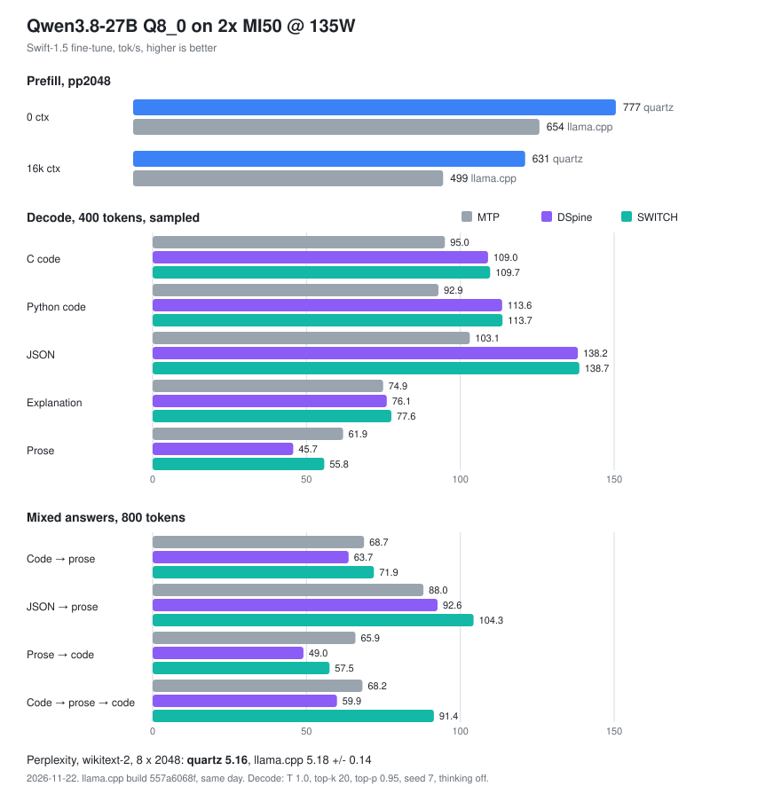

<div align="center">

<picture>
  <source media="(prefers-color-scheme: dark)" srcset="docs/images/logo-dark.svg">
  
</picture>

<h3>An inference engine for AMD MI50 GPUs</h3>

<p>
<a href="#models">MODELS</a> &nbsp;·&nbsp;
<a href="#install"><b>INSTALL</b></a> &nbsp;·&nbsp;
<a href="#api">API</a> &nbsp;·&nbsp;
<a href="#documentation">DOCS</a>
</p>

<p>
<a href="LICENSE"></a>
<a href="https://discord.gg/sKjBBtNmJ"></a>
</p>

quartz is a small inference engine for **two-card** gfx906 (MI50/MI60 32 GB) systems.<br>
It runs a short list of models as **Q8_0** GGUF files only (other quantisations are refused).<br>
It needs **exactly two cards with P2P** between them: no single-card or 4-card mode.

</div>

## Models

<details open>
<summary><picture><source media="(prefers-color-scheme: dark)" srcset="docs/images/qwen3.8-27b-dark.svg"></picture></summary>

<br>

| Role | Model |
|:---|:---|
| **Target** | [Qwen3.8-27B Q8_0](https://huggingface.co/unsloth/Qwen3.8-27B-GGUF?show_file_info=Qwen3.8-27B-Q8_0.gguf), or any fine-tune (e.g. Swift) quantised to Q8_0. It must keep the MTP block |
| **DSpine drafter** *(optional)* | [Qwen3.8-27B DSpine draft](https://huggingface.co/aj9o9/Qwen3.8-27B-DSpine-b16-GGUF?show_file_info=Qwen3.8-27B-DSpine-b16-Q8_0.gguf) |
| **Vision projector** *(optional)* | [Qwen3.8-27B mmproj](https://huggingface.co/unsloth/Qwen3.8-27B-GGUF/blob/main/mmproj-F16.gguf) |

| Feature | Details |
|:---|:---|
| **Speculative decode** | A drafter proposes several tokens and the target verifies them in one pass. **MTP** uses the target's own built-in draft block; **DSpine** uses a separate small draft model (usually faster on code, slower on prose). With DSpine loaded, decode switches between the two by acceptance rate (`QZ_NO_SWITCH=1` turns that off) |
| **Megakernel execution** | Persistent decode loop tuned for MI50 / gfx906 |
| **Batched prefill** | 2048-token chunks |
| **Vision** | Image input through the vision projector |

<picture>
  <source media="(prefers-color-scheme: dark)" srcset="docs/images/qwen3.8-27b-bench-dark.svg">
  
</picture>

<details>
<summary>Numbers</summary>

<br>

| Prefill | 0 ctx | 16384 ctx |
|:---|---:|---:|
| **quartz** pp2048 | 777 tok/s | 631 tok/s |
| llama.cpp pp2048 | 654 tok/s | 499 tok/s |

| Decode, 400 tokens | MTP | DSpine | SWITCH |
|:---|---:|---:|---:|
| C code | 95.0 tok/s | 109.0 tok/s | 109.7 tok/s |
| Python code | 92.9 tok/s | 113.6 tok/s | 113.7 tok/s |
| JSON | 103.1 tok/s | 138.2 tok/s | 138.7 tok/s |
| Explanation | 74.9 tok/s | 76.1 tok/s | 77.6 tok/s |
| Prose | 61.9 tok/s | 45.7 tok/s | 55.8 tok/s |

| Mixed answers, 800 tokens | MTP | DSpine | SWITCH |
|:---|---:|---:|---:|
| Code → prose | 68.7 tok/s | 63.7 tok/s | 71.9 tok/s |
| JSON → prose | 88.0 tok/s | 92.6 tok/s | 104.3 tok/s |
| Prose → code | 65.9 tok/s | 49.0 tok/s | 57.5 tok/s |
| Code → prose → code | 68.2 tok/s | 59.9 tok/s | 91.4 tok/s |

| Perplexity | quartz | llama.cpp |
|:---|---:|---:|
| wikitext-2, 8 × 2048 | 5.16 | 5.18 ± 0.14 |

<sub>llama.cpp: build 557a6068f, tensor split, flash attention, f16 KV, ubatch 2048, run on the same day. Prefill is the median of three runs. Decode is sampled (T 1.0, top-k 20, top-p 0.95, seed 7), thinking off, prompts of about 30 tokens, one run each. Perplexity scores the second half of each 2048-token window, as llama-perplexity does.</sub>

</details>

</details>

<br>

<details>
<summary><picture><source media="(prefers-color-scheme: dark)" srcset="docs/images/inkling-2-mini-dark.svg"></picture> <i>(roadmap)</i></summary>

<br>

[Inkling-2-Mini GGUF](https://huggingface.co/bartowski/thinkingmachines_Inkling-2-Mini-GGUF): not supported yet.

</details>

## Install

### Requirements

- Two AMD MI50/60 32 GB cards with PCIe peer access, and ROCm
- About 59 GB of VRAM across the two cards at the default context with DSpine
- A C++17 compiler, Python 3 with `jinja2`
- The target model GGUF (optional: the DSpine draft and the vision projector)

The [requirements guide](docs/requirements.md) has the details.
### 1. Build

```bash
make
```

This produces `build/bin/libquartz.so`.

### 2. Run

```bash
# MTP decode
python3 quartz/server/quartz_server.py --model <target.gguf>
```

```bash
# DSpine drafter + vision
python3 quartz/server/quartz_server.py \
  --model  <target.gguf> \
  --dspine <draft.gguf> \
  --mmproj <projector.gguf>
```

The server listens on `127.0.0.1:8090`. Pass `--host 0.0.0.0` to expose it on the network.
It has **no authentication** and handles **one request at a time**, so keep it behind a
firewall or a reverse proxy.

See [Troubleshooting](docs/troubleshooting.md) if it does not come up.

<details>
<summary><b>Logs and per-request JSON traces</b></summary>

<br>

The server logs to stderr. `QZ_TRACE` adds one JSON file per request:

```bash
mkdir -p logs && QZ_TRACE=logs/trace python3 quartz/server/quartz_server.py \
  --model <target.gguf> --dspine <draft.gguf> 2>&1 | tee logs/server.log
```

`python3 quartz/server/quartz_trace.py logs/trace` lists the requests;
pass one file to see its prompt, raw output and tool calls.

</details>

## API

The server exposes OpenAI-compatible chat completions:

```bash
curl http://127.0.0.1:8090/v1/chat/completions \
  -H 'Content-Type: application/json' \
  -d '{
    "model": "quartz",
    "messages": [{"role": "user", "content": "Write a haiku about GPUs"}],
    "stream": true
  }'
```

Images (needs `--mmproj`) use the standard OpenAI content parts:

```bash
curl http://127.0.0.1:8090/v1/chat/completions \
  -H 'Content-Type: application/json' \
  -d '{
    "model": "quartz",
    "messages": [{"role": "user", "content": [
      {"type": "text", "text": "What is in this image?"},
      {"type": "image_url", "image_url": {"url": "data:image/png;base64,<BASE64>"}}
    ]}]
  }'
```

`tools` in the request are rendered through the model's chat template and tool
calls are parsed back into OpenAI `tool_calls`. `GET /v1/models` and `GET /health`
are also available.

Run `python3 quartz/server/quartz_server.py --help` for every option; the
[configuration reference](docs/configuration.md) lists them with their defaults.

## Documentation

- [Requirements](docs/requirements.md): hardware, model files, toolchain
- [Configuration](docs/configuration.md): every flag and variable, with defaults
- [Troubleshooting](docs/troubleshooting.md): start-up failures and what to do about them
- [Architecture](docs/architecture.md): how a request becomes tokens on two cards
- [Server](docs/server.md): endpoints, request fields, responses, traces
- [Testing](docs/testing.md): checking a change, how the benchmarks were measured
