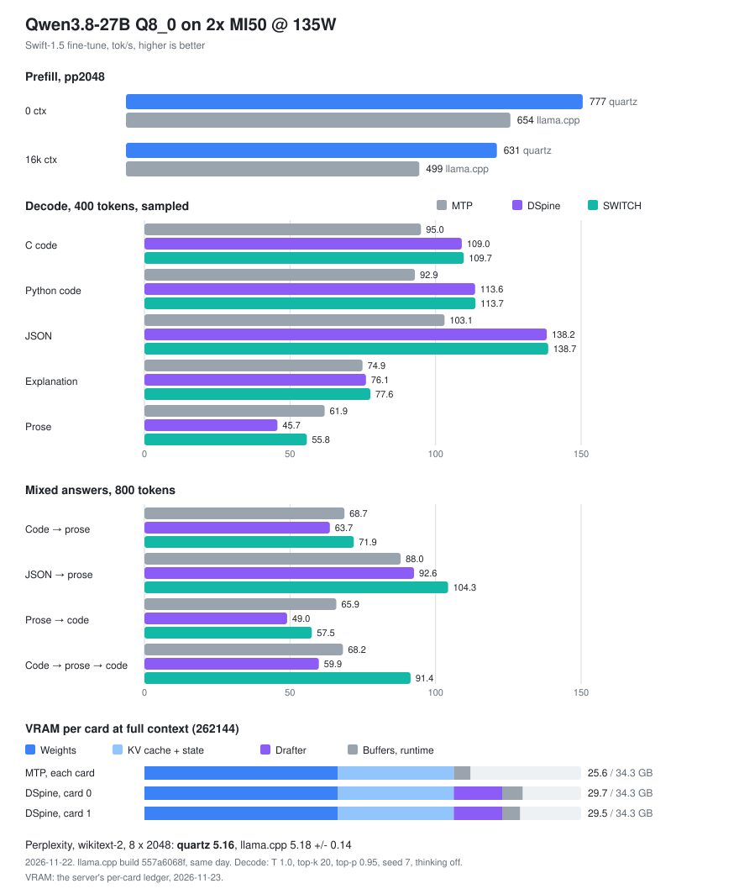
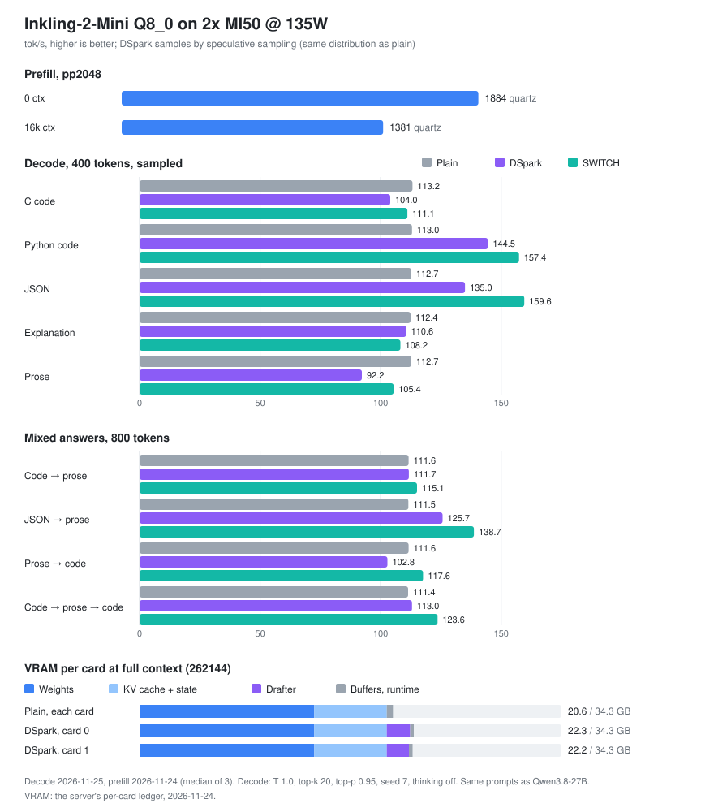

<div align="center">

<picture>
  <source media="(prefers-color-scheme: dark)" srcset="docs/images/brand/logo-dark.svg">
  
</picture>

<h3>built for AMD MI50 GPUs</h3>

<p>
<a href="#models">MODELS</a> &nbsp;·&nbsp;
<a href="#install"><b>INSTALL</b></a> &nbsp;·&nbsp;
<a href="#api">API</a> &nbsp;·&nbsp;
<a href="#documentation">DOCS</a>
</p>

<p>
<a href="LICENSE"></a>
<a href="https://discord.gg/sKjBBtNmJ"></a>
</p>

quartz is a small inference engine for **two-cards** gfx906 (MI50/MI60 32 GB) systems.<br>
It runs a short list of models as **Q8_0** GGUF files only (other quantisations are refused).<br>
It needs **exactly two cards with P2P** between them: no single-card or 4-card mode.

</div>

## Models

<details open>
<summary><picture><source media="(prefers-color-scheme: dark)" srcset="docs/images/models/qwen3.8-27b-dark.svg"></picture></summary>

<br>

| Role | Model |
|:---|:---|
| **Target** | [Qwen3.8-27B Q8_0](https://huggingface.co/unsloth/Qwen3.8-27B-GGUF?show_file_info=Qwen3.8-27B-Q8_0.gguf), or any fine-tune quantised to Q8_0 that keeps the MTP block |
| **DSpine drafter** *(optional)* | [Qwen3.8-27B DSpine draft](https://huggingface.co/aj9o9/Qwen3.8-27B-DSpine-b16-GGUF?show_file_info=Qwen3.8-27B-DSpine-b16-Q8_0.gguf) |
| **Vision projector** *(optional)* | [Qwen3.8-27B mmproj](https://huggingface.co/unsloth/Qwen3.8-27B-GGUF/blob/main/mmproj-F16.gguf) |

| Feature | Details |
|:---|:---|
| **Speculative decode** | Drafted tokens are verified by the target in one pass. **MTP** drafts with the target's own MTP block, **DSpine** with a separate draft model. With DSpine loaded, decode switches between the two on acceptance rate |
| **Persistent decode** | One kernel per card runs the whole model for each round |
| **Batched prefill** | 2048-token chunks |
| **Prefix cache** | Recurrent state snapshots in host memory |
| **Vision** | Image input through the projector |

<picture>
  <source media="(prefers-color-scheme: dark)" srcset="docs/images/bench/qwen3.8-27b-dark.svg">
  
</picture>

</details>

<br>

<details>
<summary><picture><source media="(prefers-color-scheme: dark)" srcset="docs/images/models/inkling-2-mini-dark.svg"></picture></summary>

<br>

| Role | Model |
|:---|:---|
| **Target** | [Inkling-2-Mini Q8_0](https://huggingface.co/bartowski/thinkingmachines_Inkling-2-Mini-GGUF) (`inkling2_loop`) |
| **DSpark drafter** *(optional)* | An Inkling-2-Mini DSpark draft as Q8_0 GGUF, passed with `--dspine` |
| **Vision projector** *(optional)* | The Inkling-2-Mini `inkling2v` mmproj (F16), passed with `--mmproj` |

| Feature | Details |
|:---|:---|
| **Speculative decode** | Each DSpark round drafts up to 7 tokens and verifies them with the anchor in one pass, its width set by the recent acceptance. Greedy output equals plain decoding; sampled output keeps the sampler's distribution (speculative sampling). Decode runs one token per step while that is faster than the rounds |
| **Persistent decode** | One kernel per card runs the 48 layer applications (24 layers, 12 of them looped 3 times) |
| **Batched prefill** | 2048-token chunks, grouped expert GEMMs |
| **Prefix cache** | Conv history snapshots in host memory; a snapshot is used while its sliding-window rows are still on the cards |
| **Vision** | Image input at the image's own resolution, up to 4096 tokens |

<picture>
  <source media="(prefers-color-scheme: dark)" srcset="docs/images/bench/inkling-2-mini-dark.svg">
  
</picture>

The forward pass quartz implements is in [docs/inkling2.md](docs/inkling2.md).

</details>

## Install

### Requirements

- Two AMD MI50/MI60 32 GB cards with PCIe peer access, and ROCm
- A C++17 compiler, Python 3 with `jinja2`
- The target model GGUF; optionally the draft and the vision projector

Memory per model and context is in the [requirements guide](docs/requirements.md).

### 1. Build

```bash
make
```

This produces `build/bin/libquartz.so`.

### 2. Run

```bash
# target only
python3 quartz/server/quartz_server.py --model <target.gguf>
```

```bash
# with drafter and vision
python3 quartz/server/quartz_server.py \
  --model  <target.gguf> \
  --dspine <draft.gguf> \
  --mmproj <projector.gguf>
```

The server listens on `127.0.0.1:8090` (`--host 0.0.0.0` exposes it). It has
**no authentication** and runs **one request at a time**: keep it behind a
firewall or a reverse proxy.

If it does not start, see [Troubleshooting](docs/troubleshooting.md).

<details>
<summary><b>Logs and per-request traces</b></summary>

<br>

The server logs to stderr. `QZ_TRACE` writes one JSON file per request:

```bash
mkdir -p logs && QZ_TRACE=logs/trace python3 quartz/server/quartz_server.py \
  --model <target.gguf> --dspine <draft.gguf> 2>&1 | tee logs/server.log
```

`python3 quartz/server/quartz_trace.py logs/trace` lists the requests;
pass one file to see its prompt, raw output and tool calls.

</details>

## API

OpenAI-compatible chat completions:

```bash
curl http://127.0.0.1:8090/v1/chat/completions \
  -H 'Content-Type: application/json' \
  -d '{
    "messages": [{"role": "user", "content": "Write a haiku about GPUs"}],
    "stream": true
  }'
```

Images (needs `--mmproj`) use OpenAI content parts:

```bash
curl http://127.0.0.1:8090/v1/chat/completions \
  -H 'Content-Type: application/json' \
  -d '{
    "messages": [{"role": "user", "content": [
      {"type": "text", "text": "What is in this image?"},
      {"type": "image_url", "image_url": {"url": "data:image/png;base64,<BASE64>"}}
    ]}]
  }'
```

`tools` are rendered through the model's chat template and tool calls come back
as OpenAI `tool_calls`. The [server reference](docs/server.md) lists the
endpoints and request fields.

## Documentation

- [Requirements](docs/requirements.md): hardware, model files, memory, toolchain
- [Configuration](docs/configuration.md): flags and environment variables
- [Troubleshooting](docs/troubleshooting.md): start-up failures
- [Architecture](docs/architecture.md): how a request becomes tokens on two cards
- [Server](docs/server.md): endpoints, request fields, responses, traces
- [Testing](docs/testing.md): checking a change
- [Adding a model](docs/adding-a-model.md): the per-architecture layout

## Credits

Credits to the gfx906 discord server community and to the mothership [ggml-org/llama.cpp](https://github.com/ggml-org/llama.cpp)
